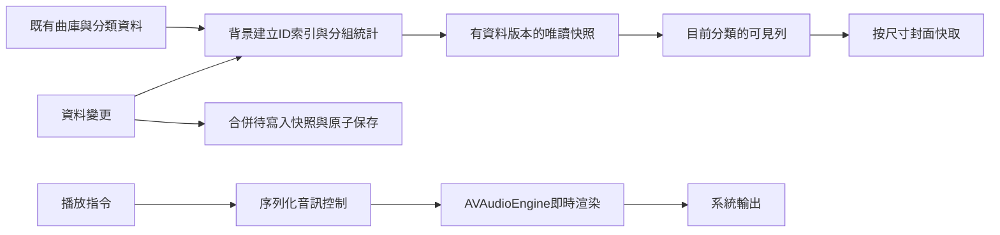

# V7 效能、音訊與介面評估

2026-10-28｜評估階段，產品基準仍為0.13.1／build17。本輪依使用者「先提出常見做法，再進行下一步設計」要求，交付程式檢查、可重現合成計算探針與建議方案。沒有更動正式播放／曲庫／介面實作，沒有部署V7。

完整英文需求：[v7-performance-audio-assessment.md](../en/v7-performance-audio-assessment.md)。使用者筆記及原圖保留；8張本輪參考圖歸檔於docs/design/references/v7/。

## 1. 已確認、推測與未取得證據

| 類別 | 內容 |
| --- | --- |
| 使用者回報 | 匯入1000多首，主要頁籤與首頁三分類切換嚴重卡頓；操作時仍有雜音 |
| 程式確認 | 音檔索引由loadLibrary載入，已有libraryLoaded避免反覆讀取；首頁預設播放清單，只有選全部歌曲才建立該區域的歌曲列 |
| 程式確認 | 首頁各分類都包含排行榜運算；歌手排序的比較器反覆filter全曲庫，artist函式又線性尋找歌手。未使用預先聚合結果 |
| 程式確認 | playCount每次filter整份聆聽事件，榜單filter和sort重複呼叫。orderedSongs每次重建字典與順序陣列，且被行／排序選單重複讀取 |
| 程式確認 | 歌手外層是VStack＋ForEach，歌曲區部分已有LazyVStack；已有LazyVStack不代表body內的資料處理也會延遲或快取 |
| 程式確認 | ContentView按page換內容並以page組合id重建ScrollView；MusicHomeView的分類／展開狀態放在局部State，切頁會失去該視圖的生命週期 |
| 程式確認 | 各區觀察同一個PlayerModel，容易因不相關變動求值；高頻PlaybackClock已隔離，不應把所有問題都歸咎於0.2秒計時器 |
| 程式確認 | collection每次修改排入FIFO全量JSON編碼／寫檔，含圖片Data；已在背景，但仍有CPU／磁碟競爭和大量拖曳時積壓的風險 |
| 程式確認 | 全部歌曲右上「自訂順序」是Label，不是Button；此為實作缺漏。現有長按移動不等於該按鈕已完成 |
| 程式確認 | updateNowPlaying僅提交歌名、作者、時長、進度、速率，沒有MPMediaItemPropertyArtwork。鎖屏缺封面有直接缺漏可修 |
| 尚未確認 | 手機實際哪個操作耗時最多、音訊deadline是否miss、是否DSP削波／參數突變／路由事件、是否只有藍牙出現雜音 |

進首頁不等於把1230首音檔全部解碼。已確認的主要問題在「整庫資料重算與視圖生命週期」，音訊檔讀取、封面解碼及磁碟寫入另需量測；不能從卡頓回報直接判定只要少載入歌曲就解決。

## 2. 隔離計算探針

重現：`python3 scripts/benchmark_library.py`，現有慢算法可能需數分鐘，腳本設編譯180秒／執行300秒上限。程式位於apps/apple/Tests/LibraryPerformanceProbe.swift，使用無聲ProbeAudio及合成資料，不讀寫使用者曲庫；分類存檔已停用。arm64 macOS、Swift 6、-O；每種資料集只跑一次，不是iPhone量測，也不包含SwiftUI佈局、封面、渲染或實際播放。

比較現有HomeLibrary中的「歌曲數目」歌手排序／當月榜計算，與只存在探針內的「一次遍歷建立字典及聚合」候選。各組完整分組順序及排行榜ID均以precondition確認一致。原始數值：[v7-synthetic-performance-baseline.json](../technical/v7-synthetic-performance-baseline.json)。

| 合成歌曲／歌手／聆聽事件 | 現有歌手分組排序 | 現有當月排行 | 候選：兩者合併聚合 |
| --- | ---: | ---: | ---: |
| 150／10／600 | 26.22 ms | 61.61 ms | 1.03 ms |
| 1230／100／0 | 20,229.29 ms | 1.28 ms | 3.29 ms |
| 1230／100／4920 | 17,537.43 ms | 2,871.32 ms | 9.25 ms |
| 1230／200／4920 | 72,458.44 ms | 2,853.36 ms | 11.18 ms |

這些數字確認現有重複計算具備足以造成長時間阻塞的成本；不能宣稱使用者手機卡了相同秒數，也不能把候選計算9.25 ms宣稱為整個App切換9.25 ms。不同組只量測一次，Set遍歷／排序比較次數、系統負載也會影響數值；沒有把17秒與20秒的差異解讀為事件數造成歌手計算加速。

## 3. 常見載入做法與本案選擇

| 做法 | 解決什麼 | 限制 | 本案建議 |
| --- | --- | --- | --- |
| 全部建立歌曲列／圖片 | 實作簡單 | 首屏、記憶體與切頁成本隨曲目增加 | 不作為長列表策略 |
| 虛擬／延遲列表：List或LazyVStack | 只建立可見／將可見列，降低UI與封面成本 | 不會自動消除filter、sort及統計的全庫計算 | 主要方案；用原生List先驗證回收和單一捲動容器，再依既有外觀評估LazyVStack |
| 50筆分批＋下一批／預取 | 限制一次加入的顯示資料、初次操作負擔 | 需要處理完整排序、播放佇列及搜尋，不能假裝只有50首 | 作為保護層，初期50筆、每次再加50筆；不是主要根因修復 |
| 一次建索引、按資料版本快取 | 避免每次點頁籤都重算分組／榜單 | 要處理失效條件及背景結果過期 | 優先做，先保留現有JSON與資料ID |
| SQLite／Core Data／SwiftData查詢與分頁 | 大規模持久化、索引及分組查詢 | 資料遷移、圖片外置與驗收成本 | 後續量測需要再評估，不因千首曲庫直接全面改資料庫 |

推薦：**索引及聚合結果快取＋可見列才建立＋封面按尺寸載入；50筆增量可作輔助。** 不建議滑到底後一次將餘下全部建立，這可能把停頓移到列表底部。若索引及虛擬列表已達標，可取消使用者看得到的分批按鈕，改為無感捲動。

建議顯示草案：進首頁保留原本分類與位置；首次點全部歌曲顯示「全部歌曲 1,230首」及前50筆，接近底部預取下一批，另留「載入更多50首」重試入口。這是供下一步討論的方案，尚未寫入App。

必要行為：搜尋、排序、排行榜及播放／隨機佇列仍使用完整曲庫，不能只對目前50首生效；自訂順序保存全庫ID順序，新增曲目接在後面，跨批拖曳／移動有一致規則。非自訂排序時，開始拖曳要切換到自訂順序並保留排序基準；取消不改資料。

## 4. 建議架構與失效條件

這是責任邊界草案，不代表已建立新actor或更換後端。保留AVAudioEngine、舊bundle／曲庫ID與七段EQ策略，先以小範圍改動取得證據。

- 以trackID→曲目、artistID→歌手、artistID→歌曲ID、清單ID→歌曲ID、月／累計次數字典取代比較器內重複搜尋。
- 匯入／刪除更新曲庫快照；歌名／歌手變更更新受影響分組／排序；評分／收藏更新對應分類；完成一次聆聽更新該曲月／累計計數。切頁、暫停、睡眠草稿與進度不使全曲庫快照失效。七天「最近新增」及跨月統計需在日期邊界／回前景檢查更新。
- 背景工作使用不可變資料，不在背景呼叫MainActor PlayerModel；用版本比對取消／忽略過期工作，完成前保留上一個有效快照。
- 首頁UI分類、展開、排序、捲動位置由較長生命週期的狀態管理；不要用把所有重頁面隱藏常駐的方式掩蓋重建成本。
- row只讀取自己的顯示資料及穩定ID；完整播放佇列在點選時由ID解析，不讓每列反覆建立完整orderedSongs陣列。
- 清單頭貼使用小尺寸快取，播放封面才取較大尺寸；避免所有小圖都解碼至1024px。只預取可見附近的有限範圍。
- 對資料保存採「保留最新待寫入完整快照、合併連續修改」候選，保留flush與失敗回報。不可丟失播放事件／評分，不在拖曳每經過一列時都寫一份完整含圖片JSON。圖片外置遷移另列後續，不與首輪混做。

## 5. 雜音排查路徑

使用者已確認V6後仍有雜音，原MP-013／MP-014保持未解決。NativeAudioPlayer是MainActor控制物件，但實際即時渲染由AVAudioEngine／系統音訊執行；不能直接將MainActor標記當成根因，也不能保證改Rust就會解決。

1. 同一首原創WAV測試片段，交叉測手機喇叭／車上藍牙、EQ開／完全旁通。補測實際有問題的歌曲格式；不必上傳私有曲庫。
2. 記錄抽屜、頁籤、換圖、截圖與音效設定的時間標記，關聯音訊session路由／取樣率／實際I/O時間與engine設定事件。UI事件不應呼叫stop、重新排程或重接音訊。
3. 依目標裝置可用工具使用Time Profiler、SwiftUI／Hangs、Allocations，以及Audio System Trace的overload／jitter／clock事件；先確認trace支援與能否重現，不冒稱已抓到render超時。
4. 同步檢查音訊deadline、圖像解碼／JSON寫入壓力、參數突變與削波。卡頓和雜音可能共因，也可能分別來自藍牙／系統路由與UI計算。
5. 若證據顯示控制命令受主執行緒阻塞，再評估獨立序列控制queue；所有engine／player控制保持一致序列，回呼只做最小轉送。即時render內不得加JSON、磁碟、鎖等待或圖像工作。若是DSP或路由問題，依該證據單獨修復，不同時引入另一音量策略。

離線PCM驗證可看音效響應與削波，無法代替真機操作期間的系統排程與藍牙測試。現階段不再單靠調大buffer作為雜音解法。

## 6. 8張標註圖的下一步規格

| 圖片尾碼 | 解讀與建議 | 狀態 |
| --- | --- | --- |
| 011733 | 保留V6的單曲⋯面板、收藏／評分／編輯／清單／確認刪App副本。確認既有功能，不重複新增入口 | 已有基礎，V7驗收 |
| 011738、011814 | 後圖覆寫前圖：內縮浮動迷你播放器，封面色霧面背景、小封面、歌名／歌手、播放／下一首、底部細進度；與頁籤列留8pt間隙。模糊只在封面改變時處理小圖並快取，避免每幀重模糊 | 草案 |
| 011743 | 右側箭頭維持位置；展開列改為單一霧面圓角工具盤、淡邊框及一致圖示／44pt點擊範圍。原順序與六項功能保留 | 草案 |
| 011748 | 表單中央封面＋右上相機按鈕；選照片／移除照片選單，沿用裁剪。下方歌曲／歌手白底輸入、標籤提示與底部取消／儲存。移除個別封面回到歌手備援；不刪歌手頭貼 | 草案 |
| 011753 | 刪除「清除評分」文字；五星右方只在rating>0時顯示清除用垃圾桶，清除後即隱藏。讀屏名稱「清除評分」，不能與下方刪音檔混淆 | 草案 |
| 011802 | 加入MPMediaItemArtwork，使用與App同一封面優先序；封面變動使metadata失效並更新，換到無圖曲目清掉舊封面；不要每秒解碼圖片 | 缺漏已確認，待實作 |
| 011808 | 縮小標籤視覺留白及間距；保留至少44pt觸控範圍、點選套用／長按排序／選定置中，避免以縮小可點區製造新問題 | 草案 |

## 7. 建議優先順序與驗收

| 階段 | 工程節點 | 具體工作 | 驗收方式 |
| --- | --- | --- | --- |
| 1 | PLAY-01／UI-01／LIB-01 | 真機建立卡頓與雜音trace基準；確認輸出及EQ條件 | 重現步驟、時間標記、trace保存；不含私有音樂進Git |
| 2 | LIB-01／UI-01 | 背景索引、聚合快取、局部觀察、頁面狀態、可見列策略；排序Label改Button | 1230／5000／10000首合成資料；排序／搜尋／佇列結果完整；真機連切20次 |
| 3 | PLAY-01 | 依trace修音訊競爭／參數／路由；確認切頁不動音訊圖 | Speaker與Bluetooth各10分鐘操作壓測，0可聽見異常；若有對應trace則不得出現相關overload |
| 4 | UI-01／PLAY-01／PROFILE-01 | 接入8張圖的表單、評分、鎖屏封面、迷你播放器及模式密度 | 375pt／橫向／大字／Reduce Motion；鎖屏封面更新及清理；操作不造成效能回退 |

候選目標：暖切頁／分類切換首個可操作畫面p95≤150ms、立即有點擊回饋、主執行緒不出現>100ms連續阻塞；這是建議驗收標準，尚未達成也未作產品保證。先比較同裝置Debug與Release量測，並把冷啟動與暖切換分開。影像／記憶體需在連續切頁後達到受控穩態，不要求把1000首音檔載入RAM。

## 8. 依據與技能

查證2026-10-28：

- [Apple：SwiftUI效能與快取／body計算](https://developer.apple.com/videos/play/wwdc2023/10160/)：應避免在body反覆做昂貴資料處理；穩定識別及快取與延遲顯示要分開處理。
- [Apple：可高效捲動的Stack](https://developer.apple.com/documentation/swiftui/creating-performant-scrollable-stacks)：Lazy容器按需建立子View，不會取代資料層重算的優化。
- [Apple：Audio System Trace](https://developer.apple.com/documentation/audiotoolbox/analyzing-audio-performance-with-instruments)：用音訊統計及執行緒資訊找出glitch／deadline問題；各目標可用性需實際確認。
- [Apple：AVAudioEngine](https://developer.apple.com/documentation/avfaudio/avaudioengine)：管理節點圖並由音訊裝置驅動即時渲染。
- [Apple：MPMediaItemArtwork](https://developer.apple.com/documentation/mediaplayer/mpmediaitemartwork)：提供系統播放封面。

使用本機PM的identify-assumptions-existing，將「先50首就會順暢」「改架構／語言就消除雜音」「模糊背景一定有負擔但未量測」分別列為需測假設；優先處理可靠性與回歸而非先疊加視覺效果。UI/UX Pro Max的SwiftUI large list performance搜尋命中List、Instruments與小型View；採用其原則，不把搜尋結果當成真機驗收。Firecrawl因DNS失敗，已改用內建搜尋查閱Apple一手資料。
